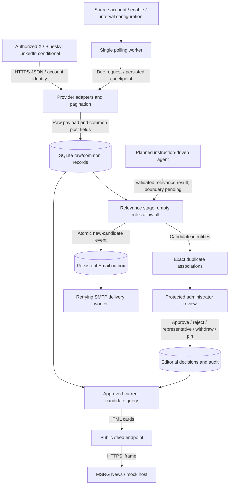

# ECE496 Implementation Plan

## ASAP: Automated Social-media Feed Aggregation Platform

University of Toronto — Department of Electrical and Computer Engineering  
Project ID: 2026400 | Section: 5  
Supervisor: Hans-Arno Jacobsen  
Administrator: Eric Lefebvre  
Team: Shengya (Lyla) Huang; Christina (Molin) Zhang; Tianyu (Tim) Ling; Zhengfei (Barry) Yu  
Submission deadline: November 7, 2026 (user-confirmed; exact submission time to confirm)  
**Working draft v0.1 — October 23, 2026. Not approved for submission.**

*Drafting note: cover information follows the submitted proposal [2]. Final formatting will place the cover on a separate page. Bracketed TEMPLATE MARKER notes are removable drafting instructions, not report prose. Main-section page limits must be checked after typesetting.*

# I. Summary of Project Status and Changes

ASAP is being developed to give the Middleware Systems Research Group (MSRG) control over collecting, reviewing and presenting social-media updates on its website. Since the Proposal, the team has implemented a local vertical slice connecting X and Bluesky retrieval to common-format normalization, SQLite persistence, duplicate grouping, administrator review and an approved-only public feed. The application includes per-source configuration, scheduled polling, manual Fetch Now, and a single-administrator interface protected by sessions and CSRF validation. Selecting a duplicate representative records separate editorial decisions without overwriting the original source posts [2]–[4].

The implementation now includes a horizontal News feed and a mock host page that embeds `/feed`. The container package starts the web application and one polling worker, with SQLite and configuration on a persistent volume. Development records dated October 13 report 99 tests passing locally and in the Linux container, successful non-root execution and state retention after restart. These results establish a local implementation baseline, not production installation or unconditional current test success. The October 23 notification-specific rerun passed six tests and encountered an SSL-context error in the remaining TLS test. Email settings and an outbox exist, but SMTP configuration and actual inbox delivery remain unverified [3], [4].

LinkedIn remains an external access dependency. Following the October 23 review, the team must verify that the Posts API and the requested Community Management access support the actual organization/member sources rather than wait for approval without confirming retrieval scope. The reviewer also requested investigation of instruction-driven agent/LLM filtering. This is proposed assisted curation; it does not establish permission for autonomous publication [5].

The next work is organized into four themes: website/iframe acceptance; agent-assisted filtering and editorial behavior; provider feasibility/extensibility and data validation; and deployment, security and Email delivery. Numerical manual ordering has been retired in favour of Pin plus newest-first. Source creator/owner attribution requires clarification and implementation. Expiry, immutable version reconciliation, fuzzy matching and independent per-site feeds remain explicit scope decisions. Significant departures from the submitted SyRS will be submitted for supervisor approval. In particular, the Proposal's less-than-48-hour objective and its one-hour conclusion must be reconciled before a final latency acceptance claim is made [2].

# II. Possible Solutions and Design Alternatives

## II.1 Evaluation basis

The alternatives below are system-level engineering options, not changes between individual Python libraries. They are assessed against the Proposal's authorized retrieval, curation, iframe delivery, extensibility, verification and maintainability requirements. The comparison is qualitative engineering analysis; numerical cost and performance claims require measurements or dated quotes. Each alternative remains dependent on permitted access to source content: a hosting architecture cannot remove a provider authorization restriction.

## II.2 Alternative A — externally managed aggregation service

MSRG could retain a managed social-feed service and use its hosted widget. Retrieval, scheduling, data management and much of the rendering would be operated outside the team-controlled backend. This minimizes custom operations and provides a short deployment path when the provider covers the required accounts. However, supported sources, refresh behavior, curation controls, extensibility and access to a repeatable internal test harness depend on the vendor. It would therefore require evidence that the selected service satisfies the proposed control and integration requirements. The existing Elfsight installation is the relevant baseline, not evidence that every managed service has the same limitations [2].

## II.3 Alternative B — scheduled generation of a static approved feed

A scheduled job could retrieve and process posts, retain review decisions in durable storage and generate static feed HTML for the website. An authenticated review interface would update the authoritative decisions before a publish job regenerates the output. The public read path would be simple and could use the existing static-site workflow. The trade-off is a second scheduling boundary between approval and website delivery, together with synchronization, protected write access and durable job-state requirements. This option still needs a runtime for acquisition and review; GitHub Pages alone does not execute the present Python worker. It would require additional design and verification of publication artifacts and state recovery.

## II.4 Alternative C — team-controlled containerized application (selected baseline)

The selected baseline runs provider adapters, processing, SQLite, a protected review backend and public HTML delivery as one containerized application with a persistent data volume. This directly extends the existing tested code, separates public reads from authorized mutations, and permits changes to a selected representative to affect subsequent feed requests without a website rebuild. Its principal obligations are hosting availability, secure HTTPS exposure, backups, external credentials and ongoing provider maintenance. SQLite and one worker are appropriate to the current single-instance design; multi-instance writes would require a separate concurrency/storage design rather than simply adding replicas.

| Criterion | A: managed widget | B: static feed generation | C: containerized ASAP |
|---|---|---|---|
| Curation/data control | Limited to vendor features | Controlled through review store and build inputs | Direct control through common store/admin |
| Public delivery | Vendor-hosted widget | Generated static HTML | Live approved-only HTML iframe |
| New provider extension | Depends on vendor | Custom adapter and generation integration | Existing contract; registry/extension proof remains |
| Operations | Mostly vendor-managed | Scheduler, state, review and publishing coordination | One runtime plus volume/proxy/backup |
| Key reliability risk | External product/access dependency | Stale artifact or inconsistent state/build | Host failure or insufficient recovery |
| Cost basis | Vendor quote and supported usage | Job/runtime/storage and maintenance | Host/storage/API/mail and maintenance |
| Reuse of current code | Low | Partial | Highest |

Alternative C is preferred because it preserves the current working vertical slice and provides the clearest verification path for administrator control and provider independence. This selection is architectural: a lab server, temporary Mac mini or managed container host are deployment choices to evaluate under the same design. An LLM may later assist the relevance module without making the entire system model-dependent. Scrapling is only a candidate retrieval investigation if official LinkedIn access proves unsuitable; it is not the selected acquisition method.

[TEMPLATE MARKER: Team/supervisor to endorse the comparison and confirm whether additional alternatives evidence is expected. Do not present a new paid-host or model choice as already approved.]

# III. Technical Design and Implementation

## III.1 Principle of operation and expanded block diagram

The design retains the Proposal's three subsystems: ingestion/monitoring; processing/persistence; and curation/presentation. Configured account adapters retrieve provider data over HTTPS. Raw and common-format records are stored by `(platform, native post ID)`. Relevance and duplicate relationships are separate derived state; administrator decisions determine publication eligibility. One selected current candidate per duplicate group can be returned by the public query. Email delivery consumes committed candidate events independently of the provider transaction.

**Figure 1. Expanded system design (working diagram; render for final report).** Solid pipeline functions exist; the agent/registry/LinkedIn additions identified below remain planned or conditional.

## III.2 Module contracts and implementation work

| Module | Inputs → outputs; operation/interface | Implementation and remaining work |
|---|---|---|
| Source configuration/scheduler | Account, enabled flag and positive interval → due adapter calls and source status. Reads persisted next-due/checkpoint state. | `source_config.py`, `app_runtime.py`, `polling.py`; verify deployment restart/cooldown and one-worker operation. |
| Provider adapters | Authorized account, credentials and checkpoint → bounded pages, native IDs, raw payload and next checkpoint. Failures retain safe diagnostics. | `providers.py`, `run_polling.py`; X/Bluesky exist. Verify LinkedIn Posts API scope before conditional adapter. Add registry/third fixture provider. |
| Normalization/repository | Provider response → common fields plus original/raw records; identity upsert and transactional readback. | `store_poc.py`; preserve platform, post ID, account, date, text, URL, links, media, metadata and raw payload. Clarify creator/owner name separately from configuring administrator. |
| Relevance/agent boundary | Stored common posts and configured instructions → candidate/filtered result. Empty configuration permits all. | `relevance.py`; agent is planned. Agree instructions/output schema, model failure behavior and human authority before runtime integration. Untrusted post text must not override governing instructions. |
| Duplicate association | Candidate text → independent exact-match group membership. | `duplicates.py`; normalize whitespace only. No fuzzy threshold or automatic platform priority is assumed. Similarity remains decision-gated. |
| Editorial service/admin | Candidate identities, authenticated/CSRF-protected actions → persisted decisions, reasons and audit events. | `web_editorial.py`, `web_app.py`, `console_ui.py`; chosen approval rejects unselected alternatives atomically; withdrawal does not revive them. Pin/newest-first is the current order. |
| Candidate notification | First candidate event and opt-in recipient → durable outbox → TLS SMTP acceptance/sent marker or retryable error. | `notifications.py`; environment-only SMTP secrets. Resolve TLS test failure, configure transport, add protected review URL and demonstrate actual receipt. SMS deferred. |
| Renderer/host boundary | Eligible common/source fields and appearance settings → escaped public HTML embedded by the host. | `feed_ui.py`, `/feed`, `/embed-demo`; verify source attribution, responsive rendering and real MSRG replacement. Admin routes remain non-embeddable. |
| Deployment/verification | Image, external settings/secrets and persistent volume → repeatable service and evidence. | Docker/Compose and test harness exist; complete hosting/proxy/backup acceptance, live provider tests and maintainer instructions. |

The polling coordinator commits source records, processing and checkpoints together; processing failure must not advance the checkpoint. Provider failures do not erase stored content. Relevance candidacy is not editorial approval. Email events share the candidate transaction, but transport failure does not roll back source data. SMTP delivery is at-least-once across a crash after remote acceptance and before the local sent marker; the design does not claim exactly-once inbox delivery.

## III.3 Implementation sequence and risk controls

Work proceeds through the four theme issues, with named ownership to be agreed. Provider-scope research and an agent POC can run alongside browser acceptance and hosting preparation. A live LinkedIn adapter requires verified permissions; official access remains pending. Any proposed crawling fallback requires permitted scope and a separate stakeholder decision. The selected runtime host and actual MSRG installation are external dependencies, whereas source/renderer tests and Docker recovery procedures can be developed locally.

Security controls retain secret injection, HTML escaping, safe URLs, sessions, CSRF and separate public/admin routes. Public deployment adds HTTPS, production cookie configuration, boundary testing and backup/restore exercises. Agent integration adds risks of incorrect relevance decisions, unavailable inference and instruction injection through external content; evaluation must measure those failures before expanding its authority. The report will not claim original-source version archives, confirmed remote deletion tracking, expiry or site-isolated decisions until their scope and implementation are accepted.

# IV. Test and Verification

## IV.1 Setup, evidence and proposed trial design

Verification combines TEST, ANALYSIS and REVIEW OF DESIGN. Tests use temporary SQLite databases, injected provider/model/mail transports, the integrated HTTP server, Docker and a host page with the real iframe. Live tests use explicitly authorized test accounts; no credentials or private payloads are placed in reports. Each run records revision, environment, test count, result and exceptions.

Historical local/container tests and browser demonstrations are completed evidence only for their dated revisions. Current notification TLS and real SMTP acceptance remain open. The following trial sizes are **proposed engineering test conditions**, not supervisor-approved performance requirements: three text/link/image fixtures per accessible provider; three repeat imports and restart cycles; ten controlled live posts per accessible authorized provider for timing; browser widths of 375, 768 and 1440 pixels in two agreed browser engines. The final corpus, trial counts and conditions must be approved before acceptance testing. Timing records API retrievability, candidate readiness, SMTP acceptance, manual approval and embedded visibility separately; actual inbox arrival is observed separately from SMTP acceptance.

## IV.2 Verification table

| SyRS ID | Method and procedure | Measurable acceptance / evidence status |
|---|---|---|
| R-01 | TEST: authorized provider fixtures/live samples; inject failures, pagination and 429; replay three times. | Every expected accessible-source native ID stored once; zero cross-account contamination; failed processing advances no checkpoint. LinkedIn remains conditional under C-01. |
| R-02 | TEST: compare text/link/image fixtures to source/common/raw readback, including names/identity where available. | All available required fields and original links preserved; zero source changes caused by grouping/review. Ownership display semantics require agreement. |
| R-03 | TEST: agreed include/exclude corpus, empty rules, invalid config and agent failures; exercise approve/reject/withdraw/group selection. | Empty rules pass all; deterministic agreed rules match every expected result; zero unapproved posts published. Agent quality threshold/corpus is TBD and cannot be claimed passed. |
| R-04 | TEST: iframe host at proposed widths/engines; exercise review actions and customization. | All approved eligible fixtures visible; zero pending/rejected/withdrawn/unselected duplicates; links/images usable and no page-level clipping. Browser automation remains to complete. |
| R-05 | TEST + REVIEW OF DESIGN: register fixture provider and execute extension instructions. | Third provider reaches review/output; X/Bluesky integrations and common processing need no modification; existing regression cases still pass. |
| R-06 | TEST: clean harness run and deliberately failing fixture. | Provider/filter/renderer/iframe results reported separately; failing case returns failure; live and fixture evidence distinguished. Current TLS failure must be resolved, not hidden. |
| R-07 | REVIEW OF DESIGN + TEST: another team member follows deployment/configuration/maintenance/extension instructions. | All four topics covered; service starts, configuration changes work, backup restores expected state and test provider works without undocumented steps. |
| R-08 | TEST + REVIEW OF DESIGN: inspect agreed live MSRG News installation and approval/withdrawal effects. | Actual production site uses ASAP instead of prior feed; zero unapproved entries; MSRG records acceptance. Not satisfied by local mock. |
| C-01 | REVIEW OF DESIGN + TEST: provider access/role/scope/limit record and permitted request evidence. | Each enabled provider has an authorized method and documented limitations; blocked providers remain disabled. |
| C-02 | REVIEW OF DESIGN: repository ownership/license and third-party attribution review. | Release available in agreed MSRG organization with selected permissive LICENSE and required notices. Pending decision/release. |
| C-03 | TEST: clean image/start, non-root check, three restart cycles and separate backup restore. | Admin/feed reachable; expected records/config/decisions survive; no local secret/database baked into image. Build/restart historical evidence exists; full recovery remains. |
| O-01 | ANALYSIS: dated usage-based cost worksheet, including hosting/API/mail/storage. | Report monthly estimate and funding sources against agreed ceiling; no cost pass threshold until ceiling/profile confirmed. |
| O-02 | TEST + ANALYSIS: proposed controlled live trials, staged timestamps and distributions. | Report max/median/p95 and human approval delay. Proposal target <48h to embedded appearance versus one-hour review target must be reconciled before pass/fail is finalized. |
| O-03 | TEST: same feed embedded in two distinct test host pages. | Identical approved output available on both without common-processing changes. Independent curation and actual QSCC deployment remain separate. |

Supplemental criteria proposed in Appendix A require the corresponding tests before they are adopted as final acceptance: protected mutation failures, replay-safe candidate notifications with actual receipt, source ownership attribution, and controlled agent output. A test count alone does not establish requirement coverage.

# References

[1] ECE496, *Implementation Plan Guidelines*, user-supplied seven-page PDF, read October 23, 2026. Course instructions; publication/version date not specified.

[2] ASAP team, *ECE496 Proposal: Automated Social-media Feed Aggregation Platform*, project 2026400, cover dated October 9, 2026, `docs/proposal/project_proposal.pdf`.

[3] ASAP repository, source, tests and deployment configuration, local working tree inspected October 23, 2026. Record final commit/hash and test log before submission; uncommitted work is not a released revision.

[4] ASAP team, *Website integration* and living requirements/architecture, `docs/website_integration.md`, `docs/functional_requirements.md`, `docs/architecture.md`; historical October 13 validation and October 23 notification-test record.

[5] ASAP team, *Implementation Review and LinkedIn Feasibility*, October 23, 2026, `docs/meeting_minutes/2026-10-23-implementation-review-and-linkedin-feasibility.md`. Distorted transcription; uncertain details explicitly flagged. Source ownership and specific Posts API follow-ups were subsequently clarified by Tianyu.

[6] LinkedIn, *Posts API*, https://learn.microsoft.com/en-us/linkedin/marketing/community-management/shares/posts-api?view=li-lms-2026-09 . Inspected October 23, 2026 during the permission-scope follow-up; final permission matrix requires further verification.

[TEMPLATE MARKER: Add final source permalinks and any external technical references actually relied upon. Do not reuse historical cost quotes as current budget evidence.]

# Appendix A. Updated System Requirements Specification — working baseline

The submitted Proposal IDs are retained. Repository FR identifiers are supplementary traceability and do not replace these IDs. Refined wording below is a **draft for review**, not a claim of supervisor approval. Each ID is verified in Section IV; unresolved acceptance parameters are explicit.

| ID | Working specification | Refinement / decision status |
|---|---|---|
| R-01 | Retrieve posts from configured LinkedIn, X and Bluesky sources for which permitted access is available under C-01; record inaccessible providers and reasons. | Retains proposal; LinkedIn scope and access pending. |
| R-02 | Represent retrieved posts in a common format preserving source platform, available content and original link, with separately retained original/raw source information. | Preserves proposal intent; current records are not an immutable version archive. |
| R-03 | Include/exclude posts according to configured relevance/curation rules; empty relevance rules allow all, and only explicit authorized approval permits publication. | Empty-rule/manual boundaries agreed; agent instructions/authority and quality criteria pending. |
| R-04 | Expose the curated feed as HTML embeddable in a website iframe, with supported text/links/images and configurable presentation. | Local implementation exists; responsive host acceptance pending. |
| R-05 | Permit an additional provider through a defined integration interface without changes to existing provider integrations or common processing. | Third-provider/registry proof pending. |
| R-06 | Provide repeatable verification for providers, filtering, rendering and iframe embedding, distinguishing fixture and live results. | Existing harness; complete browser coverage and current regression recovery. |
| R-07 | Document deployment, configuration, maintenance and provider extension; verify instructions through execution. | Existing documents; independent walkthrough and recovery/extension evidence pending. |
| R-08 | Supply the curated feed used in the actual MSRG production website in place of its prior third-party feed, with stakeholder acceptance. | Proposal names msrg.org; confirm current production hostname and deployment before approval of revised wording. |
| C-01 | Use provider-permitted access mechanisms, authorization and usage limits. | API availability never implies permission for arbitrary-account retrieval or all downstream use. |
| C-02 | Publish under a permissive license in the MSRG GitHub organization. | License/ownership acceptance pending; public personal repo alone is insufficient. |
| C-03 | Support Docker deployment using supplied instructions and persistent application state. | Local build/run evidence; deployment recovery acceptance remains. |
| O-01 | Minimize recurring cost, preferring free operation. | Usage profile, dated estimate and acceptable ceiling pending. |
| O-02 | Reduce refresh delay; Proposal table target is <48h from authorized retrievability to embedded appearance. | Proposal conclusion requests 1h; draft review-ready objective differs. Supervisor must confirm final boundary/threshold and whether mandatory. |
| O-03 | Support future qscc.ca use without common-processing changes, demonstrated through a second test website. | Does not automatically require independent site curation or QSCC production installation. |

## A.1 Supplemental acceptance candidates and change log

| Candidate / proposed ID | Proposed specification / measurable evidence | Approval status |
|---|---|---|
| S-01 Email | Opt-in Email event when a source identity first becomes a review candidate; replay creates zero additional events, transport failures retain a retryable outbox, and authorized test email reaches the recipient. | Email channel agreed; live setup pending. At-least-once SMTP crash semantics explicitly retained. |
| S-02 Source ownership | Retain/display agreed source creator/owner identity without confusing it with the configuring/reviewing administrator; missing names are not fabricated. | Requested by Michalis per user clarification; define exact field semantics and placement. |
| S-03 Admin boundary | One environment-password administrator; protected session/CSRF, production Secure cookie and HTTPS; unauthorized/invalid-CSRF mutations fail and admin pages cannot be framed. | Current MVP decision; differs from Proposal MFA mitigation prose. Confirm formal change record. |
| S-04 Agent filtering | Agent evaluates stored posts against agreed instructions and returns validated, explainable results; it cannot gain publication authority through post content. | Exploration requested; acceptance threshold, failure policy and authority require approval. |

Before finalizing these supplemental IDs, add matching Section IV rows with agreed procedures and criteria. No final SyRS row may remain without verification. Expiry, fuzzy matching, version history and independent-site curation require accept/defer dispositions; planned scope is not implementation evidence. Scrapling is an under-evaluation candidate only if the official LinkedIn route is unsuitable and a permitted POC is authorized.

# Appendix B. Work plan and Gantt inputs — ownership not yet assigned

The following is a proposed sequence for team review, not a booked course schedule. The user confirmed the four theme owners are not assigned. Do not substitute guessed names. Final Gantt durations/effort and dependencies must be reconciled with the Proposal chart, then rendered as an actual chart showing completed work, remaining work, owners and milestones.

| Work package | Proposed window / milestone | Dependency | Owner | Effort input |
|---|---|---|---|---|
| B0 Existing ingestion/storage/admin/mock/container baseline | Completed/local evidence through Oct 13; current TLS regression open | Historical implementation | Record actual contributors | Actual hours TBD |
| B1 LinkedIn Posts API/access feasibility finding | Oct 23–Nov 1 planning window | Documentation/account-role clarification; access response external | TBD (#29) | h1 TBD |
| B2 Agent instructions, authority and fixture set | Oct 23–Nov 3 planning window | Stakeholder decision | TBD (#28) | h2 TBD |
| B3 Finalize plan/SyRS/alternatives/verification and budget | Oct 23–Nov 6; submit by Nov 7 | Team owners/hours, supervisor review | Team; editor TBD | h3 TBD |
| B4 Agent filtering POC and runtime configuration | Nov–Dec proposed | B2; model/resource decision | TBD (#28) | h4 TBD |
| B5 Provider extension and permitted live E2E | Nov–Jan proposed | B1 for LinkedIn; test credentials | TBD (#29) | h5 TBD |
| B6 Hosting/HTTPS/backup/SMTP acceptance | Nov–Jan proposed | Runtime host and mail credentials; TLS diagnosis | TBD (#30) | h6 TBD |
| B7 Browser harness and actual MSRG staging iframe | Nov–Feb proposed | Mock tests independent; external install requires B6/site permission | TBD (#27) | h7 TBD |
| B8 Integrated acceptance and defect correction | Jan–Feb proposed | B4–B7 accepted scope | All; coordinator TBD | h8 TBD |
| B9 Production replacement/recovery/maintainer acceptance | Feb–Mar proposed | B8, MSRG authorization | TBD (#27/#30) | h9 TBD |
| B10 Final report/release/course demonstrations | Dates to verify with course | Evidence from B8–B9 | All; coordinator TBD | h10 TBD |

Milestone dates other than the user-provided November 7 deadline are draft planning windows. The October meeting did not establish an interim-demo date; do not assert a Christmas/post-Christmas date. Final Gantt must include person-specific hours so financial labor totals can be calculated as task estimates rather than a guessed overall total.

# Appendix C. Financial plan — quantities and quotes pending

Report currency: **CAD, proposed**. Convert any USD quotes using a dated rate and include taxes where applicable. No paid host, domain purchase, mail plan or model service is approved by this draft.

| Category / priority | Item | Quantity / cost basis | Estimated project cost | Cash expense / contribution / retained item |
|---|---|---|---|---|
| Shared equipment / P1 | Existing development machines; optional temporary Mac mini | Existing personal equipment; incremental cost/valuation to confirm | TBD; commercial value separate if included | No new purchase planned; personal hardware remains with owner |
| Service / P1 | Runtime host and persistent storage | Approved monthly rate × operating months | TBD quote | Lab-provided cash cost $0 only if confirmed; otherwise hosted-service budget |
| Service / P1 | X and any approved provider access | Expected requests × current authorized tariff | TBD quote/usage | Identify payer/contribution; do not assume API access is free |
| Service / P1 | Email transport | Expected review events/month × selected service tariff | TBD quote | Sender/SMTP approval and cost needed; SMS excluded/deferred |
| Service / P1 | Backup storage | Retention × storage rate | TBD | Confirm whether provided with host |
| Service / P2 | Domain | Existing subdomain/provider URL preferred | $0 incremental if available; otherwise TBD | No purchase required yet; identify owner if purchased |
| Service / decision-gated | Agent inference | Local resources or authorized API usage | TBD after model decision | Do not charge for an unselected model service |
| Software/license | Selected software and attribution | License review; fees if any | TBD review | Open-source availability alone is not the project's license approval |
| Labor, excluded from funding request | Team implementation/testing/documentation | Sum of person-specific task hours from B × assumed hourly rate | H × r, with H/r TBD | In-kind student labor, not requested from course |
| Contingency | Required-service/price/access changes | Named high-priority alternatives; reserve to agree | TBD | No invented reimbursement commitment |

**Cost calculation:** estimated total project cost = approved equipment/shared/service costs + student labor estimate (H × r) + agreed contingency. Actual cash funding need excludes student labor and free supplied items. Course funding request = eligible cash expenses less applicable student contributions, supervisor support and other confirmed contributions, floored at zero and subject to course eligibility rules. The guideline expects each student to cover the first $100 of project expenses before requesting additional funding; the final table must show actual contributions and eligible allocations rather than automatically treating $400 as spent.

**Contingency:** prioritize durable data, authorized access and secure deployment. If funding/hosting is delayed, continue fixture/browser testing locally and evaluate one existing Mac mini as a temporary test host only after availability/security/resource review; do not claim it is production infrastructure. If paid inference is unavailable, retain manual review/default allow-all while evaluating a suitable local POC. If LinkedIn access is unavailable, document the provider limitation and continue X/Bluesky acceptance rather than purchase an unapproved retrieval service. Funding applications are separate from this report.

[TEMPLATE MARKER: Fill per-person work allocations and labor rate, service quotes, operating months, contributions, taxes/exchange assumptions, retained-item owners and contingency amount before submission.]
